# Carton Caps analytics pipeline

A local, tested prototype of the analytics pipeline described in the brief: synthetic data generator → bronze / silver / gold pipeline → queryable outputs for **school fundraising, referral-program effectiveness, user engagement and purchase behaviour**.

| Deliverable | Where |
|---|---|
| 1. Data generation | [`data_generator.py`](data_generator.py) · assumptions in [`docs/DATA_ASSUMPTIONS.md`](docs/DATA_ASSUMPTIONS.md) |
| 2. Architecture & design spec | [`docs/ARCHITECTURE.md`](docs/ARCHITECTURE.md) (diagram, tech choices, schema, DQ, incremental, scaling, monitoring, AWS, governance, trade-offs, evolution) |
| 3. Working pipeline | [`pipeline/`](pipeline) · tests in [`tests/`](tests) · sample analysis in [`queries/`](queries) |

## Quick start

Developed and tested on Python 3.13. Two dependencies: `duckdb`, `pytest`.

```bash
pip install -r requirements.txt

python data_generator.py            # 1) generate data  -> data/*.csv (+ SQLite copy)
python -m pipeline.run              # 2) run pipeline   -> warehouse/carton_caps.duckdb + warehouse/export/*.parquet
python scripts/run_sample_queries.py  # 3) 22 sample analyses
python scripts/build_report.py      # 4) charts -> reports/index.html (open in a browser)
pytest                              # 5) 80 tests, ~30 s
```

(`make all` does the same. `make demo-dq` and `make scale` run the two demos below.)

Query the result yourself:

```bash
python -c "import duckdb; print(duckdb.connect('warehouse/carton_caps.duckdb', read_only=True).sql('select * from gold.mart_school_fundraising limit 5'))"
# or: duckdb warehouse/carton_caps.duckdb      (the DuckDB CLI)
# or: any tool that reads warehouse/export/*.parquet
```

Useful flags: `--sqlite <file>` (read from SQLite instead of CSV: our own generated `.db`, **or the challenge's `Carton_Caps_Data.sqlite` itself**, auto-detected and mapped by an adapter; a copy is in `sample_data/`, try `make sample` or `python -m pipeline.run --sqlite sample_data/Carton_Caps_Data.sqlite --db warehouse/sample.duckdb --no-export`), `--rebuild-from-bronze` (re-derive silver and gold from the raw log), `--max-reject-rate 0.02` (tighter circuit breaker), `--source-dir`, `--db`, `--no-export`. Exit code 2 means a data-quality gate stopped the run.

## See it first: the report

[`reports/index.html`](reports/index.html) is a self-contained page (inline SVG, no external requests, light/dark, hover tooltips) built from the gold tables by `scripts/build_report.py`: activity (DAU/WAU/MAU), chatbot engagement, a cohort-retention heatmap, school leaderboard, referral funnel and network, purchase patterns, and what the quality layer caught on corrupted data. Every chart title is a finding computed from the data, not typed in.



## What the pipeline does

```
CSV / SQLite ─▶ BRONZE ─────────▶ SILVER ──────────────▶ GOLD ───────────────▶ Parquet + DuckDB
               raw, all-text,    typed, 82 row checks,   dims + facts + 19 marts,  queries/*.sql
               append-only,      quarantine + retry,     partition-incremental    
               file-hash idempotent  latest-valid wins   facts, 13 reconciliations
```

- **Ingestion** is idempotent (content hash), checks a schema contract, and tolerates new columns. Sources are pluggable (`CsvSource`, `SqliteSource`, and `SampleSchemaSource`, a thin adapter that lets the pipeline read the challenge's own SQLite file). Six entities: schools, users, products, purchases, referrals and the in-app chatbot's messages.
- **Silver** casts, normalises, validates and de-duplicates. Bad rows go to `quarantine.*` with their reasons instead of being dropped; rows missing only a parent record are retried every run, so late-arriving dimensions heal themselves. If more than 10% of a batch is rejected the run **rolls back and exits non-zero** rather than publishing a half-empty warehouse.
- **Gold** is a small dimensional model (`dim_user`, `dim_school`, `dim_product`, `dim_date`, `fct_purchases`, `fct_referrals`, `fct_user_daily_activity`) plus marts. Every table's grain and purpose is listed in [ARCHITECTURE.md §3](docs/ARCHITECTURE.md). No direct PII reaches gold, and chatbot message text never leaves silver (gold holds counts only).
- **Incremental:** new files, corrections and late data are handled as described in [§5](docs/ARCHITECTURE.md); a test proves that loading in two batches gives byte-identical results in all 27 gold tables to loading once.

### Required analytics outputs

| Brief asks for | Table(s) |
|---|---|
| User cohort analysis with retention | `mart_cohort_retention_weekly`, `mart_cohort_retention_monthly` |
| School fundraising aggregations and rankings | `mart_school_fundraising`, `mart_school_fundraising_monthly` |
| Referral network analysis and conversion funnel | `mart_referral_funnel`, `mart_referral_funnel_monthly`, `mart_referral_network`, `mart_referral_generations`, `mart_referral_effectiveness` |
| Product purchase patterns and trends | `mart_product_monthly`, `mart_product_lifetime`, `mart_category_monthly`, `mart_purchase_heatmap`, `mart_category_affinity`, `mart_user_segments`, `mart_purchase_concentration` |
| Daily active users by school | `agg_daily_active_users_by_school` (+ `mart_daily_platform_activity` for DAU/WAU/MAU; active = purchase or chatbot message, via `fct_user_daily_activity`) |
| User engagement (chatbot) | `mart_chat_engagement`, `mart_chat_adoption_by_school`, `fct_user_daily_activity` |
| Data quality checks with handling | `meta.dq_results`, `quarantine.*`, `pipeline/entities.py`, `pipeline/quality.py` |

## Results at a glance

Real output from the default run (seed 42, 1,000 users, 10,000 purchases, 1,000 invites). Full output: `python scripts/run_sample_queries.py`.

**Referral funnel** (Q4): of 977 eligible invites, 41% are clicked, 18% become signups and 16% are *qualified* (first purchase within 7 days). 85% of signups qualify.

| stage | invites | % of sent | % of previous |
|---|---:|---:|---:|
| invite sent (eligible) | 977 | 100% | |
| link clicked | 405 | 41.5% | 41.5% |
| signed up | 179 | 18.3% | 44.2% |
| qualified | 152 | 15.6% | 84.9% |

**School fundraising** (Q1, top 3 of 50): total raised = purchase donations + referral bonuses.

| rank | school | state | purchase donations | referral bonus | total |
|---:|---|---|---:|---:|---:|
| 1 | Rivendell Middle School | IL | $177.20 | $255.00 | $432.20 |
| 2 | Nite Owl Elementary School | CA | $93.82 | $115.00 | $208.82 |
| 3 | Veidt High School | IL | $69.99 | $105.00 | $174.99 |

**Retention** (Q9): share of users who joined during the window and bought in week *N* after signing up: 37% in week 0 (activation takes a few days), 56% in week 1, 49% in week 4, 28% in week 11.

**Concentration** (Q16): the heaviest 10% of buyers make 36.5% of purchases; the top 30% make two thirds.

**Network** (Q7): one teacher sent 197 invites → 32 direct signups → a network of 35 people two levels deep. The 15% of users who invite at all drive everything.

> ⚠ Read these as *demonstrations of the pipeline*, not findings about Carton Caps. The data is synthetic, and some of what it "shows" was planted by the generator (e.g. referred users activate faster: `mart_referral_effectiveness`). [DATA_ASSUMPTIONS.md](docs/DATA_ASSUMPTIONS.md) lists which constants (points → dollars, the $5 bonus, what "active" means) are assumptions of mine rather than facts from the brief.

## Data-quality demo

```bash
make demo-dq     # or: python data_generator.py --dirty-rate 0.01 --output-dir data_dirty && python -m pipeline.run --source-dir data_dirty --db warehouse/dirty_demo.duckdb
```

Injects about 1,600 problems across the six sources (duplicates, negative quantities, orphan keys, NULL prices, garbage timestamps, purchases and chat messages before signup, blank or invalid-sender messages, self-referrals, bad e-mails, ...). The run:

```
entity      ingested     new retried recov. quarant.  dupes  merged
users           1000    1000       0      0       20      0     980
purchases      10100   10100       0      0      626     90    9384
referrals       1000    1000       0      0       28      0     972
chat_messages  13842   13842       0      0      843    124   12875
gold models built: 17   reconciliation failures: 0
```

`SELECT … FROM quarantine.purchases` shows why each row was held. Note `orphan_user = 237`: only 100 were injected; the other 137 are *genuine purchases by the 20 users that were themselves quarantined* (bad e-mail, unknown school). The same happens to 256 chat messages from those users. They are held as retryable and will load by themselves if corrected user rows arrive. With `--max-reject-rate 0.02` the same data trips the circuit breaker: silver is rolled back, the evidence is kept in `meta.dq_results`, and the process exits with code 2.

## Scale check

`make scale` runs 100x the sample volume (100k users, 1M purchases, 1.3M chatbot messages, 100k referrals) through the same code: **~17 s end to end** on one container (157 MB warehouse, 30 MB Parquet). Profiling an earlier run found one model (rolling weekly/monthly active users) taking ~10 s, which I rewrote as an interval sweep (**23x faster, identical output, test-locked**); the Parquet export is now the biggest single step. See [ARCHITECTURE.md §6](docs/ARCHITECTURE.md).

## Repository layout

```
data_generator.py         synthetic data (schools, users, products, purchases, referrals, chatbot messages) + optional dirty data
pipeline/
  config.py               business constants: point value, referral bonus, qualify window, breaker threshold
  entities.py             per-entity contract: columns, types, DQ rules (error / warn / retryable)
  ingest.py               bronze: sources (CSV, SQLite, challenge-schema adapter), schema contract, hash idempotency
  silver.py               typing, validation, quarantine/retry, dedupe, upsert, circuit breaker
  gold.py + sql/gold/*.sql  dimensional model and marts (plain SQL), partition-incremental facts
  quality.py              post-build reconciliation checks
  run.py                  CLI entrypoint
tests/                    80 tests: generator, DQ/silver, gold maths, chatbot source, sample-DB adapter, incremental == from-scratch
sample_data/              the challenge's own sample SQLite (input for the adapter)
queries/sample_queries.sql   22 analyses     scripts/run_sample_queries.py   runner     scripts/build_report.py   HTML report
reports/index.html         the charts report (regenerate: make report)
docs/                     ARCHITECTURE.md · DATA_ASSUMPTIONS.md · the referral rules PDF
```

## Tests

`pytest` (80 tests, ~30 s). Highlights:

- **Gold maths against a hand-computed world** (`test_gold_transforms.py`): 5 users, 6 purchases, 5 referrals, every expected number derived on paper in the file's docstring (retention rates, DAU/WAU, school ranks and ties, funnel stages, qualification boundary, network depth).
- **Incremental == from scratch** across all 27 gold tables, including a correction that moves a purchase to another date.
- **DQ behaviour**: every rule quarantines with the right reason; warn rules load; a bad update never overwrites a good row; orphans are released when the parent arrives; the breaker rolls back and stays quiet on tiny batches.
- **Chatbot and adapter**: hand-computed user-day activity (sessions, chat-only days), "active = purchase or chat" semantics, DQ rules with the right reasons, orphan release, message text never present in any gold table, the sample-DB adapter on a copy of the challenge's DDL, and a brute-force check of the rolling-active-user maths.
- **Generator properties**: determinism, foreign keys, nothing before signup, 10–30% conversion, heavy-tailed volume, weekend/evening patterns, referral rules (no self-referral, referrer exists before invite, referred user is new).

## Known limitations

- "Active" means "bought something or sent a chatbot message"; there are no app-open or scan events in the data. Cohort retention is purchase-based on purpose (purchases fund schools).
- `points → dollars` ($0.01) and "qualified referral" (first purchase within 7 days) are my assumptions; both are single constants in `pipeline/config.py`.
- Dimensions are Type 1: if a user changes school, history is not restated.
- The provided `Carton_Caps_Data.sqlite` has a different schema from the generator and almost no data (34 users, 484 chatbot messages, no purchases). The generator's schema is the pipeline's contract and `SampleSchemaSource` maps the sample file onto it, inventing a few columns it lacks (listed in [DATA_ASSUMPTIONS.md §2](docs/DATA_ASSUMPTIONS.md)). Run on the real file the pipeline loads everything with zero rejects.
- Hard deletes and out-of-order replays of an *older* version of a row are not handled (documented in [ARCHITECTURE.md §5](docs/ARCHITECTURE.md)).
- Cloud design is a written plan, not deployed infrastructure.
