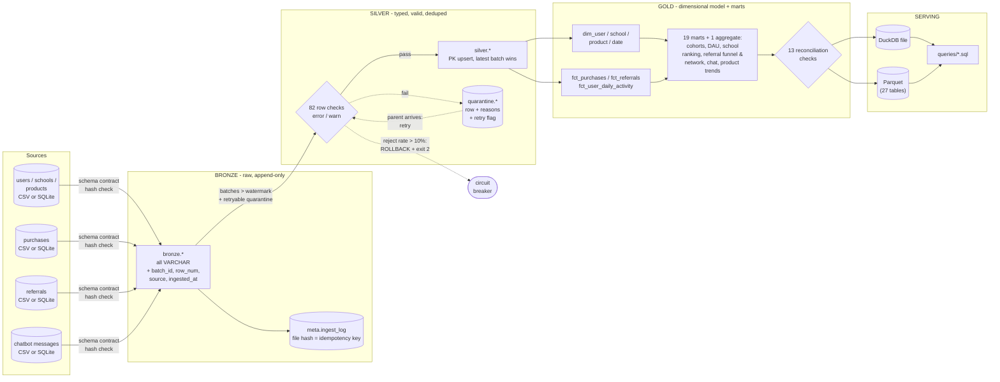
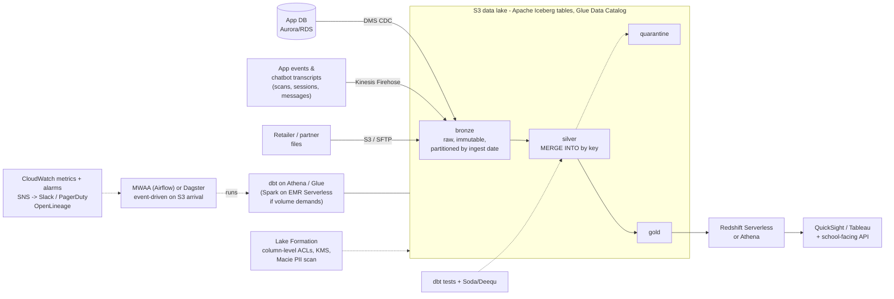

# Carton Caps analytics pipeline: architecture & design

*Deliverable 2. What is **built and tested** in this repo is marked ✅; what is **designed but not built** is marked 📐.*

## 0. Summary

The prototype is a three-layer (bronze / silver / gold) batch pipeline on **DuckDB + SQL + Python**, run by one command. It ingests six sources (schools, users, products, purchases, referrals and the in-app chatbot's messages), validates them with 95 data-quality checks, quarantines bad rows instead of dropping them, loads incrementally, and publishes **27 gold tables** for school fundraising, referral effectiveness, cohort retention, active users, chatbot engagement and purchase behaviour, as DuckDB tables and Parquet files. It also runs unchanged on the SQLite file supplied with the challenge, through a small schema adapter (section 4).

I chose tools that make the *design* visible and testable on a laptop (80 tests, about 30 s) rather than tools that need provisioning, and wrote every layer so it maps one-to-one onto a managed AWS stack (section 7). I measured the prototype at **100x the sample volume** (1M purchases, 1.3M chatbot messages, 100k users, 100k referrals): the full pipeline finishes in about 17 s on one container (section 6).

## 1. Architecture

### 1.1 Data flow (as built ✅)


<details><summary>Mermaid source (renders natively on GitHub)</summary>



</details>

Every step also logs to `meta.runs`, `meta.run_metrics` and `meta.dq_results`. The same flow as text, with the code that implements each step:

```
sources ──ingest.py──▶ bronze ──silver.py──▶ silver ──gold.py──▶ gold ──quality.py──▶ Parquet
 CSV/SQLite   hash-skip      append-only   rules in entities.py   sql/gold/*.sql   reconciliation
              contract check                quarantine + retry     partition-incremental facts
```

### 1.2 Target cloud architecture on AWS (📐 designed, not built)



<details><summary>Mermaid source</summary>



</details>

| Prototype ✅ | AWS 📐 | Azure equivalent 📐 |
|---|---|---|
| Local files / SQLite | S3 landing + DMS CDC, Firehose | ADLS Gen2, Data Factory, Event Hubs |
| `bronze.*` DuckDB tables | Iceberg tables on S3 (Glue Catalog) | Delta Lake on ADLS (Unity Catalog / Purview) |
| `silver.py` `INSERT OR REPLACE` | Iceberg `MERGE INTO` | Delta `MERGE INTO` |
| `sql/gold/*.sql` + Python runner | dbt models (SQL carries over unchanged apart from dialect) | dbt on Synapse / Fabric |
| DQ rules in `entities.py` | dbt tests + Soda/Deequ | same / Great Expectations |
| `python -m pipeline.run` | MWAA/Dagster DAG, event-triggered | Data Factory / Fabric pipelines |
| `meta.*` tables | CloudWatch metrics + Iceberg audit tables | Azure Monitor |
| Parquet export | Redshift Spectrum/Athena over gold Iceberg | Synapse serverless / Fabric Lakehouse |

## 2. Technology choices and why

| Choice | Why this | Why not the alternatives |
|---|---|---|
| **DuckDB** as the engine | Columnar and vectorised, so it handles 1M-row aggregates in tens of milliseconds; full SQL (window functions, recursive CTEs, `QUALIFY`, `FILTER`) which the cohort and referral-network models need; transactional DDL gives atomic layer builds and rollback; zero install. Reads and writes Parquet natively, so the serving format is the one the cloud lake uses | SQLite: no columnar execution, weak analytics SQL. Postgres: needs a server and is row-oriented. Spark: 100x too heavy for this volume and slows down every test run. pandas: no SQL, harder to review and port |
| **SQL files for gold, Python only for control flow** | The transformation logic is the part a reviewer wants to read, and the part that ports directly to dbt | A Python-DataFrame transform layer would hide logic in code and not port |
| **Declarative DQ rules** (`entities.py`) | Each rule is one named line of SQL with a severity and retry flag; adding a check is a one-line change; the same list produces the checks, the quarantine reasons and the `meta.dq_results` rows | Ad-hoc `assert`s scattered through transforms |
| **Parquet export** | Engine-agnostic hand-off to BI tools, notebooks, or the future lake | Only a `.duckdb` file would lock consumers to this engine |
| **pytest + tiny hand-computed fixtures** | The gold tests use a 5-user world whose every number was worked out on paper (see the docstring of `test_gold_transforms.py`) | Snapshot tests of large outputs prove nothing about correctness |

## 3. Schema design for the analytical outputs ✅

Kimball-style: conformed dimensions, three fact tables, aggregate marts built from the facts. The grain is stated for every table.

### Dimensions and facts

| Table | Grain | Key | Refresh |
|---|---|---|---|
| `dim_date` | one day | `date_day` | full |
| `dim_school` | school | `school_id` | full |
| `dim_product` | product | `product_id` | full |
| `dim_user` | user | `user_id` | full. **No PII**: e-mail replaced by `email_hash`, names dropped. Carries lifetime measures, `is_legacy`, `is_referred`, `purchase_segment` |
| `fct_purchases` | purchase line | `purchase_id` | **partition-incremental** on `purchase_date` |
| `fct_referrals` | invite | `referral_id` | full. Cumulative funnel flags `is_sent/clicked/converted/qualified`, `is_existing_member` |
| `fct_user_daily_activity` | user x day | `(user_id, activity_date)` | **partition-incremental** on `activity_date`. One row per day a user did *anything*: purchases, revenue, donation, chatbot messages and sessions, `did_purchase`, `did_chat`. The single definition of an "active user". **No message text**: counts only |

### Marts (all rebuilt from the facts; the daily school aggregate is partition-incremental)

| Table | Grain | Answers |
|---|---|---|
| `agg_daily_active_users_by_school` | day x school | **Daily active users by school** (purchase or chatbot), split into purchasing and chatting users, plus purchases, units, revenue, donations |
| `mart_daily_platform_activity` | day | DAU, trailing 7-day WAU, 28-day MAU (active = purchase or chat), stickiness, buying vs chatting users, messages, sessions, new users. First 27 days flagged `is_warm_up` |
| `mart_cohort_retention_weekly` / `_monthly` | cohort x period | **Retention curves**: cohort size, active users, rate; `new` vs `legacy` cohort type; `is_complete_period` flags the partial last period |
| `mart_school_fundraising` | school | **Fundraising totals and rankings**: purchase donations + referral bonuses, overall / within-state rank, quartile, per-user yield |
| `mart_school_fundraising_monthly` | month x school | Monthly rank and month-over-month growth |
| `mart_referral_funnel` | funnel stage | **Conversion funnel**: sent -> clicked -> signed up -> qualified |
| `mart_referral_funnel_monthly` | send month | Rates, median time to convert, bonus cost, K-factor |
| `mart_referral_effectiveness` | acquisition type | Referred vs organic: activation, repeat rate, days to first purchase, revenue per user (mature users only) |
| `mart_referral_network` | referrer | **Network analysis**: invites, conversions, total descendants, max depth, rank (recursive CTE) |
| `mart_referral_generations` | generation | Shape of the referral forest |
| `mart_chat_engagement`, `mart_chat_adoption_by_school` | chatted vs never-chatted, school | **Chatbot engagement**: share of users who chat, buyer rate and revenue per user for each group, chat days that include a purchase, adoption by school. Counts only, and a correlation, not an effect |
| `mart_product_monthly` / `_lifetime`, `mart_category_monthly` | product x month, product, category x month | **Purchase trends**: rank, share, month-over-month growth, repeat-buyer rate |
| `mart_purchase_heatmap`, `mart_user_segments`, `mart_purchase_concentration`, `mart_category_affinity` | weekday x hour, user type x segment, decile, user type x category | **Purchase behaviour patterns**, incl. a power-law check |

Design notes: a dimension row carries `is_legacy` rather than inventing a signup cohort for pre-window users; marts expose *numerators and denominators* (`active_users`, `cohort_size`) next to rates so they can be re-aggregated correctly; `fct_purchases.school_id` is the school *at load time* (Type 1; see section 9).

## 4. Data quality ✅

Four layers, each catching a different class of failure:

| Layer | Where | What it catches | Action |
|---|---|---|---|
| **1. Contract** | `ingest.py` | Missing required column, unknown extra column, same file delivered twice | Missing -> hard fail (exit 2). Extra -> log schema drift, ignore. Duplicate file -> skip (hash) |
| **2. Row rules** | `entities.py`, applied in `silver.py` | 82 checks: nulls, failed casts, ranges, e-mail format, referential integrity, business rules (self-referral, purchase before signup, converted without timestamp, converted before sent, ...) | **error** -> row goes to `quarantine.<entity>` with its reasons; **warn** -> row loads, failure is counted. Fixable problems are *repaired, not rejected*: status case/whitespace, e-mail case, wrong `day_of_week` (re-derived), unknown `user_type` -> `unknown`. Exact duplicates collapse (counted) |
| **3. Batch gate** | `silver.py` | Systemic breakage: a bad deploy upstream, wrong file, truncated export | If > 10% of a new batch (>= 50 rows) is rejected, **roll the entity back**, write the evidence to `meta.dq_results`, exit 2. Gold is not rebuilt, so consumers keep the last good data |
| **4. Reconciliation** | `quality.py` | Errors in *our* transforms: fan-out joins, lost partitions, double counting | 13 checks after gold build, e.g. fact revenue = silver revenue, school donations = fact donations, cohort sizes = user count, funnel monotonic, activity fact messages = silver chat messages |

Design decisions worth calling out:

- **Quarantine, don't drop.** The rejected row, the reason(s) and whether it will be retried are all kept. A row that failed only for a *missing parent* (`orphan_user`, `orphan_school`, ...) is marked `_retryable` and re-evaluated on every run, so late-arriving dimensions heal automatically (tested). A row that failed for a bad value is not retried.
- **A bad update never overwrites a good record.** Validation runs *before* de-duplication, so if batch 2 corrects purchase 17 with an invalid quantity, the batch-1 version stays in silver and the correction sits in quarantine (tested).
- **Warn vs error is a business call, made per rule and visible in the code.** E.g. `price_exceeds_list` is a warn (a retailer price change would otherwise reject real sales); `self_referral` is an error because the program rules prohibit it.
- **Absolute thresholds are not enough.** The breaker is a *rate over a minimum batch size* so a 5-row correction file with one bad row does not trip it (tested both ways).
- 📐 In production I would add: schema-registry-backed contracts, distribution drift (e.g. mean basket size +/- 3 sigma vs trailing 4 weeks), freshness SLAs per source, and per-source reject-rate thresholds.

## 5. Incremental updates ✅

| Situation | Behaviour | Test |
|---|---|---|
| Same file delivered twice | Content hash already in `meta.ingest_log` -> skipped, nothing rebuilt ("gold up to date") | `test_same_file_is_ingested_once` |
| New increment (`purchases__2024-07-02.csv`) | New bronze batch. Silver processes only batches above the entity's **watermark** | `test_incremental_load_equals_from_scratch_build` |
| Correction to an existing row (same key, later batch) | Upsert; the latest *valid* batch wins. The old and new `purchase_date` are both marked dirty | same |
| Late-arriving parent | Quarantined orphan is retried each run and released when the parent lands | `test_orphans_are_held_and_released_when_parent_arrives` |
| Rows moved to another date | Both partitions rebuilt in `fct_purchases` and `agg_daily_active_users_by_school` | same property test |
| Gold build crashes midway | One transaction: rollback; `meta.pending_gold_dates` survives, next run redoes the same partitions | by construction |
| Logic change / disaster recovery | `--rebuild-from-bronze` drops silver, quarantine, gold and re-derives them from the immutable bronze log | `test_rebuild_from_bronze_reproduces_silver_and_gold` |

**The key correctness property** is tested directly: loading batch 1 then batch 2 incrementally gives *exactly the same rows in all 24 gold tables* as loading both at once from scratch.

Why a batch-id watermark and not a source `updated_at`: the sources carry no change timestamp, and ingestion order is the one ordering the pipeline controls. If the real source exposes `updated_at` or a CDC LSN, silver should order by that instead of batch id (a one-line change in the `ORDER BY` of the dedupe).

### Source adapter for the challenge's sample database ✅

The brief ships `Carton_Caps_Data.sqlite` with different table and column names from the generator's. Rather than ignore it, `ingest.SampleSchemaSource` maps it onto the pipeline's contract, and `python -m pipeline.run --sqlite <file>` auto-detects which schema it is looking at. The mapping is deliberately thin and every invented value is listed in the class docstring and in `DATA_ASSUMPTIONS.md`: `Users.name` is split into first/last name; `Products` get a category inferred from the product name and a default earn rate (the source has neither); `Purchase_History` has no price, so `price_paid = quantity x list price`; `Conversation_History` becomes `chat_messages`; there is no referrals table, so that entity is empty. Run on the real file it loads 7 schools, 10 products, 34 users and 484 chatbot messages with zero rejects and zero reconciliation failures (the file has no purchases, so the commerce marts are empty and the engagement marts carry the data). This is the same adapter-per-source pattern production would use for each new system: bronze stays generic, the mapping is one small class.

The chatbot text is the one free-text field in the data. Users sometimes type personal details into a bot, so silver flags messages that contain an e-mail address or phone number (`possible_pii_in_message`, a warn rule), message text never leaves silver, and gold holds only counts.

What is **not** handled: hard deletes (needs tombstones from CDC), and a source *re-sending an older version after a newer one has been loaded* (needs a source version column; batch order would let the old row win).

## 6. Scaling to 100x ✅ measured, 📐 extrapolated

### Measured

The generator and pipeline were run at 100x the sample (`python data_generator.py --users 100000 --schools 500 --purchases 1000000 --referrals 100000`, single container, no tuning):

| Stage | 10k purchases | 1M purchases | 
|---|---:|---:|
| Generate data | ~1 s | ~55 s |
| Ingest (6 files, ~115 MB CSV at 1M purchases + 1.3M chat messages) | < 0.5 s | ~2 s |
| Silver (82 row checks, 2.5M rows at 1M) | 0.4 s | ~5 s |
| Gold (27 tables) | 0.2 s | ~3 s |
| Reconciliation + Parquet export | ~0.9 s | ~7 s |
| **Pipeline total** | **1.5 s** | **~17 s** |
| Warehouse file | 15 MB (block overhead) | 157 MB (30 MB as Parquet) |

**A bottleneck I found and fixed.** The first measurement showed one model, rolling 7/28-day distinct users, taking 9-10 s of the ~21 s total because it was a range join (O(days x purchases)). I rewrote it as an interval sweep (merge each user's coverage windows into islands, running-sum the +1/-1 events over the calendar), which is O(user-days): **10.3 s -> 0.45 s at 1M purchases with identical output**, locked in by a test that compares it with the brute-force definition. The total fell from ~21 s to ~11 s at the time; adding the chatbot source (1.3M more rows at this scale) brings it to the ~17 s shown above, and the Parquet export is now the largest single step, which is the next thing I would look at.

**Honest reading:** at this size DuckDB rebuilds everything faster than I can make the incremental path matter. The partition-incremental design is there to be correct and ready for the volume where it pays off, not because the prototype needs it.

### What breaks first, and what I'd do (📐)

| Pressure point | Why | Fix |
|---|---|---|
| Next hotspots at 1M: ingest and silver (~4 s each) | Row-by-row validation SQL over every new row, and CSV parsing | Parquet inputs; validate only new partitions; push checks into the warehouse engine. Rolling-active users (formerly the hotspot) is already O(user-days); HyperLogLog sketches if even that grows too large |
| Single-writer file DB | One process at a time; no concurrent readers during a rebuild | Iceberg tables with snapshot isolation; serve from Redshift/Athena |
| Full re-read of bronze for backfills | Fine to ~10^9 rows | Partition bronze by ingest date; process only affected partitions |
| Small files | Frequent small batches -> many tiny Parquet files | Iceberg compaction jobs, target 128-512 MB files |
| Silver FK checks | Joins against whole dimension tables | Broadcast the (small) dimensions; for huge dimensions, check only against keys touched in the batch |
| Hot keys | A few schools / referrers dominate (power law) | Salting only if a skewed join shows up in the profile; most marts aggregate first, join second |
| Orchestration | One process, no retries or backfill UI | Airflow/Dagster with per-entity tasks, retries and sensors; backfills as parameterised runs |

**When to leave a single node:** roughly when the *working set* of a rebuild no longer fits comfortably in memory (hundreds of GB), or when more than one team needs to query concurrently during loads. Before that, a bigger machine is cheaper and simpler than a cluster. For Carton Caps, even 100M purchases is a few GB of Parquet.

## 7. Production considerations 📐

### Deployment on AWS

- **Network & compute:** pipeline tasks run as ECS Fargate / EMR Serverless / Glue jobs in private subnets; S3 and Glue via VPC endpoints; no public ingress.
- **Environments:** `dev`, `staging`, `prod` as separate accounts under AWS Organizations; infra in Terraform; CI runs `pytest` plus `dbt build` against a seeded staging catalog on every PR; promotion by tag.
- **Orchestration:** S3 object-created events -> EventBridge -> DAG run, so ingestion is event-driven rather than clock-driven; a daily schedule remains as a backstop that detects *missing* deliveries.
- **Storage layout:** `s3://cc-lake-<env>/{bronze,silver,quarantine,gold}/<entity>/`, Iceberg, partitioned by `ingest_date` (bronze) and `event_date` (silver/gold facts). Lifecycle: bronze to Glacier Instant Retrieval after 90 days, never deleted unless a privacy request requires it.
- **Cost controls:** Athena workgroup scan limits; Parquet+ZSTD; partition pruning; compaction; budget alarms per workgroup.

### Monitoring and alerting

What the prototype already records (`meta.runs`, `meta.run_metrics`, `meta.dq_results`) is exactly what these alerts need; in AWS the same rows are emitted as CloudWatch metrics.

| Signal | Detect | Alert when | Severity |
|---|---|---|---|
| Run failed / breaker tripped | `meta.runs.status = 'failed'` | any | Page |
| **Freshness** | newest `bronze._ingested_at` per source | > SLA (e.g. 26 h for a daily feed) | Page |
| **Volume anomaly** | `new_rows` per entity vs trailing 7-run median | < 50% or > 200% | Warn |
| **Reject rate** | `quarantined / new_rows` per entity | > 2% warn, > 10% breaker | Warn / Page |
| **Quarantine backlog** | retryable rows older than N days | > 0 after 3 days (a parent never arrived) | Warn |
| Schema drift | log from contract check | any new column | Warn |
| **Reconciliation failure** | `meta.dq_results` where `entity='gold'` | any | Page |
| Duration | `run_metrics.seconds` | > 2x trailing median | Warn |
| Business sanity | e.g. DAU -40% day over day, referral conversion rate outside 5-40% | beyond threshold | Warn to analytics owner |
| Cost | Athena bytes scanned, S3 requests | budget 80% | Warn |

Alerts go to SNS -> Slack (warn) / PagerDuty (page). Every alert links to the run id and the `dq_results` query that explains it. Lineage via OpenLineage so "what depends on this column?" is answerable before a change.

### Data governance and privacy

This data is about **families and children's schools**, so it is treated as sensitive even though it contains no card numbers or health data.

- **PII minimisation by layer.** Name and e-mail exist only in bronze/silver. **Gold has no direct identifiers**: `dim_user` carries `email_hash` and numeric ids (✅ built and tested: `test_gold_dimension_has_no_direct_pii`). Analysts get gold only.
- **Access control (📐):** Lake Formation column-level grants; roles `pipeline` (write all), `analyst` (read gold), `steward` (read silver, quarantine). Quarantine tables hold raw PII and are restricted like silver.
- **Encryption:** S3 SSE-KMS with per-environment keys, TLS in transit, KMS key policies scoped per role.
- **Retention & deletion:** Right-to-delete (CCPA/state laws; COPPA if the app ever stores data about under-13 users): the user id is the join key everywhere, so a deletion request is "delete from bronze/silver where user_id = X, then rebuild affected partitions". Iceberg row-level deletes make this cheap; `--rebuild-from-bronze` is the fallback. Bronze PII older than the retention period is tokenised.
- **Discovery:** the pipeline flags e-mail addresses and phone numbers typed into chatbot messages (✅ `possible_pii_in_message`, a warn rule in silver) and keeps message text out of gold. In production Macie scans the lake for PII that shows up in other places it shouldn't.
- **Referral data is data about a third party:** `referred_email` belongs to someone who has not signed up. It must not be used for anything but matching the invite to a later signup, should be hashed in silver, and be purged after the conversion window (e.g. 90 days for unconverted invites). In the prototype it stays in silver for the self-referral and existing-member checks.
- **School-facing reporting:** per-school numbers shown to a school should suppress small cells (e.g. fewer than 10 users) to avoid identifying individual families.
- **Auditability:** every silver row carries `_batch_id` and every bronze row its source file and load time, so any number can be traced back to the file it came from.

## 8. Key design decisions and trade-offs

| # | Decision | Alternative | Trade-off accepted |
|---|---|---|---|
| 1 | Bronze is **all-VARCHAR and append-only** | Typed on load | Costs a cast per run; in exchange a malformed value can never block landing data and any logic change can be replayed |
| 2 | **Quarantine + retry** for bad rows, plus a **rate breaker** for bad batches | Fail-fast on any bad row, or silently drop | More moving parts than either; avoids both stopping the pipeline for one bad row and quietly losing 30% of the data |
| 3 | Silver is **upserted incrementally**; marts are **full refresh**; only the three large daily tables (purchases, user-day activity, school DAU) are partition-incremental | Everything incremental, or everything full | Marts being full refresh means they are always correct by definition; incremental complexity is spent only where volume grows |
| 4 | **Batch-id ordering** for "latest wins" | Source `updated_at` | Correct for in-order delivery; wrong if an old version is replayed later (documented) |
| 5 | **Type-1** dimensions; `fct_purchases.school_id` is as-of-load | SCD Type 2 | If a family moves schools, history is not restated and a school's past fundraising doesn't move with them. Acceptable here; SCD2 on `dim_user` is the first evolution step |
| 6 | **"Qualified referral" = first purchase within 7 days** | Wait for a real scan/onboarding event | A proxy: it can both over- and under-credit. Configurable and clearly named |
| 7 | **1 point = $0.01** | Unknown | Invented. Fundraising totals are directionally right only, so donations and bonuses are reported as separate columns |
| 8 | SQL files + tiny runner | dbt from day one | No dbt dependency to install; a reviewer reads plain SQL. Cost: no automatic DAG or docs. The port is mechanical (replace `{{...}}` params with Jinja/vars, split multi-statement files) |
| 9 | Cohort retention measured as **"bought in week N"** | "Was active (bought or chatted)" | Purchases are what funds schools, so retention is transacting retention. The activity fact already has everything needed to add an engagement-retention variant |
| 10 | Cohorts: window signups by signup period; pre-window users in one `legacy` cohort | Fabricate signup cohorts | `legacy` retention measures survival from an arbitrary start, so it isn't comparable to `new` cohorts and is labelled that way |

## 9. Assumptions and constraints

- Batch, not streaming: daily (or hourly) file/table drops. Nothing in the questions asked needs sub-minute latency.
- Sources arrive as full files or increments with a stable primary key (`*_id`). No hard deletes.
- All timestamps are UTC. One currency.
- "Active" means "bought something or sent a chatbot message". There is no app-open or scan event in the data; if one exists in production it joins `fct_user_daily_activity` as one more column and every active-user metric picks it up.
- The prototype assumes it is the only writer to the DuckDB file.
- Business constants (point value, bonus, qualify window, breaker threshold) live in `pipeline/config.py` and are CLI-overridable where useful.
- Data volumes: sample 10k purchases; tested to 1M; designed (not tested) beyond.

## 10. Evolution path

1. **Now (✅):** local batch pipeline, tested, reproducible from bronze.
2. **Next:** move SQL to dbt, DQ rules to dbt tests + Soda, run on Athena/Iceberg with MWAA; keep the same layer names and table grains so dashboards don't change.
3. **Real activity events:** ingest app events (scan, session, share) and redefine `agg_daily_active_users_by_school` on them; add a true "qualifying action" for referrals; add install events to enforce the 48-hour window.
4. **History:** SCD2 `dim_user` (school, type); snapshot referral status changes rather than only the latest state.
5. **Fraud signals:** device / payment fingerprints per the rules PDF s5 (shared device across referrer and referred, burst patterns, referral rings from `mart_referral_network`) feeding a review queue.
6. **Incremental marts & sketches:** incremental cohort tables; HLL sketches for rolling-window metrics at much larger scale.
7. **Serving & experimentation:** a metrics layer (semantic definitions of "active", "qualified", "raised" in one place), reverse-ETL of school leaderboards into the app, and an experiment table so A/B tests of referral incentives (the $5 bonus) can be analysed.
8. **Streaming** only if a product need appears (e.g. live school leaderboards): CDC -> Kafka/Kinesis -> Iceberg, with the batch silver rules reused as the validation step.
